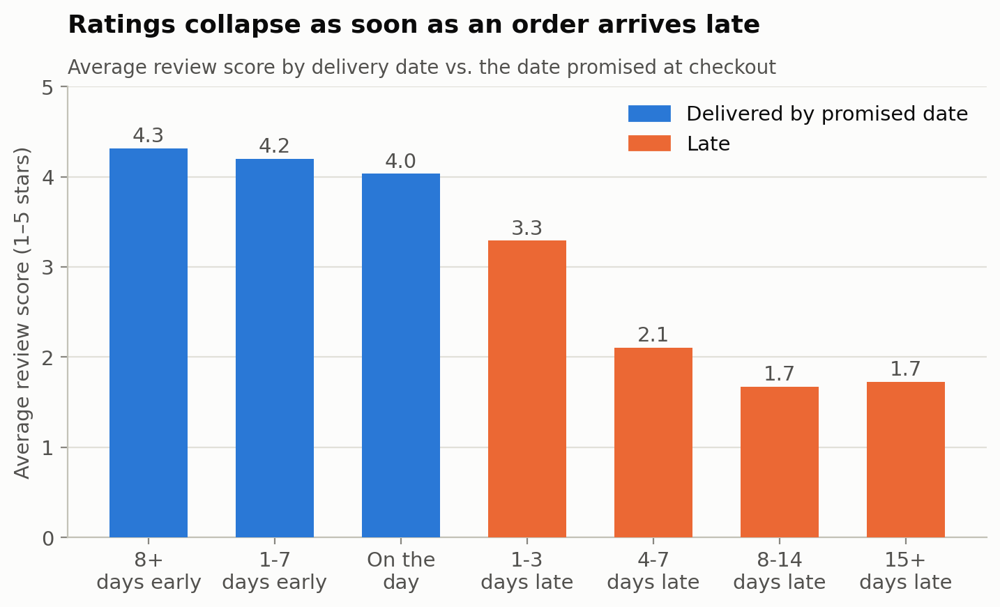
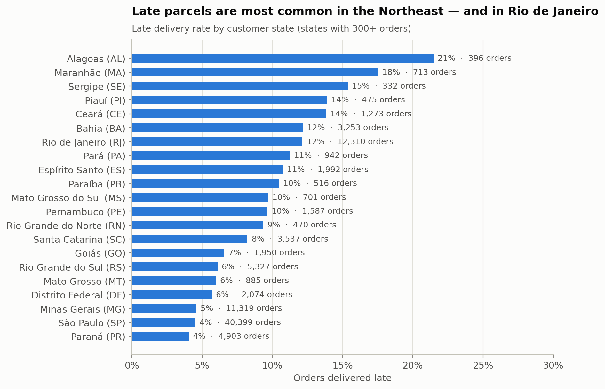
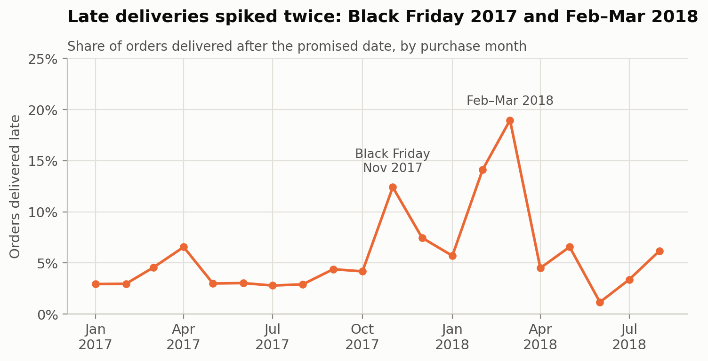
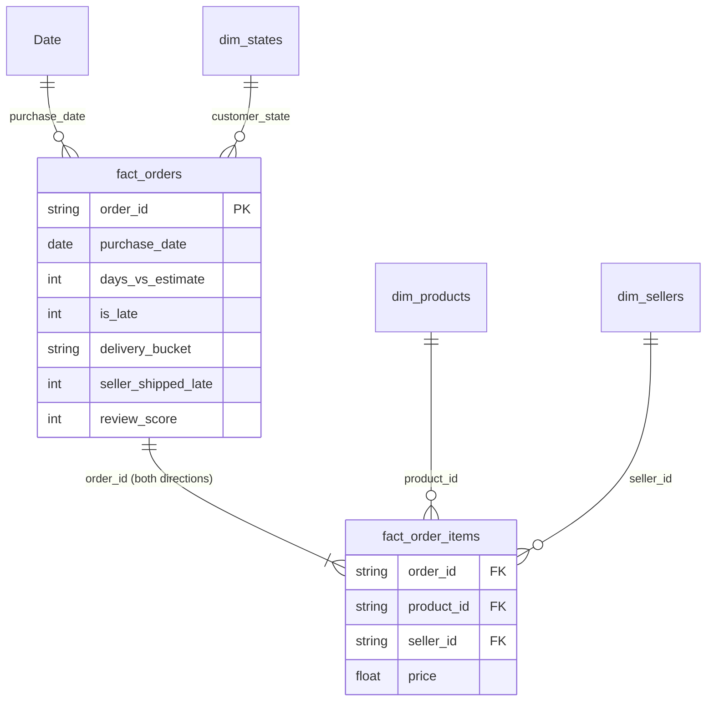

# E-commerce Delivery & Customer Reviews — Power BI Dashboard

**Business question:** How much do late deliveries cost an online marketplace in customer ratings, and where and when do they happen?

**Data:** 96,203 delivered orders from Olist, a Brazilian e-commerce marketplace (January 2017 – August 2018): orders, items, sellers, products and customer reviews.

**Tools:** Power BI (data model, DAX, report) · Python/pandas (data cleaning and cross-checking every dashboard number)

<!-- DASHBOARD SCREENSHOTS: after building the report (powerbi/BUILD_GUIDE.md), add:


-->

---

## Key findings

**1. A late delivery costs about two stars.**
Orders that arrive after the promised date average **2.3 stars**, against **4.3 stars** for orders on time. **62%** of late orders get a 1- or 2-star review, compared with 9% of on-time orders.

**2. The first late days matter most.**
The rating is still 4.0 when a parcel arrives on the promised day. It falls to 3.3 at 1–3 days late and 2.1 at 4–7 days late. The broken promise matters more than the speed: on-time orders that took 20–30 days still average 4.0 stars, while late orders that arrived within 10–15 days average only 3.2.



**3. Late deliveries are concentrated by region.**
**12.8%** of orders to the Northeast arrive late, against about 6% in the Southeast and South, and up to 21.5% in Alagoas. Rio de Janeiro stands out among large markets: 12.1% of its 12,310 orders were late. That is 1,495 late orders, close to São Paulo's 1,817 from less than a third of the volume.



**4. Late sellers lead to late parcels.**
**8.9%** of orders were handed to the carrier after the seller's shipping deadline. Those orders reached the customer late **21.1%** of the time, compared with 5.4% when the seller shipped on time.

**5. Two spikes, not a steady problem.**
In most months the late rate stays below 8%. It jumped to 12.4% for November 2017 orders (Black Friday) and 14–19% in February–March 2018.



## What I would recommend

1. **Enforce seller shipping deadlines.** Late handover is the clearest lever inside the marketplace's control; flagging sellers who repeatedly ship late would target the orders most likely to go wrong.
2. **Set more realistic delivery promises for the Northeast and Rio de Janeiro.** On average, orders arrive 11.8 days *before* the promised date, so there is room to promise more accurately in low-risk regions and more cautiously in high-risk ones.
3. **Plan carrier capacity before peaks.** The Black Friday spike was predictable. The February–March 2018 spike needs a closer look (carrier issues? weather? a large seller?) before the next season.

These are associations in observational data. A next step would be to test them, for example by comparing sellers before and after a deadline-enforcement change.

---

## Data model

A star schema, built in `analysis/prepare_data.py`:



- **fact_orders:** one row per delivered order, with delivery timing, review score and seller handover.
- **fact_order_items:** one row per item, which links orders to products and sellers.
- **dim_states:** Brazilian states with IBGE regions. **dim_products:** English category names. **dim_sellers:** seller location.
- **Date:** a DAX-generated calendar table.

## DAX

All measures are in [`powerbi/measures.dax`](powerbi/measures.dax). A few examples:

```dax
Late Delivery Rate = DIVIDE ( [Late Orders], [Delivered Orders] )

Avg Score Late = CALCULATE ( [Avg Review Score], fact_orders[is_late] = 1 )

Late Rate All States = CALCULATE ( [Late Delivery Rate], REMOVEFILTERS ( dim_states ) )

Late Rate vs Average = [Late Delivery Rate] - [Late Rate All States]

Late Rate MoM Change =
IF ( NOT ISBLANK ( [Late Rate Previous Month] ),
     [Late Delivery Rate] - [Late Rate Previous Month] )
```

**Validation:** every measure is also computed in pandas (`analysis/reference_numbers.py`). The dashboard is checked against the expected values in [`powerbi/reference_numbers.md`](powerbi/reference_numbers.md).

## Data cleaning

| Issue | Decision |
|---|---|
| 2,963 orders not delivered (canceled, unavailable, in transit) | Removed; there is no delivery to measure |
| 8 orders marked delivered with no delivery date | Removed |
| 267 orders from 2016 and Sep/Oct 2018 (a handful per month) | Removed; the analysis covers Jan 2017 – Aug 2018 |
| 547 orders with more than one review | Kept the most recent review |
| 643 orders without a review | Kept; review score left blank so averages ignore them |
| 1,350 orders picked up by the carrier before payment approval | Timestamp inconsistency in the source; kept, but not used in any measure |
| 610 products without a category; 2 categories without an English name | Labelled "Unknown"; translated manually |

**"Late"** means the parcel reached the customer on a later calendar day than the delivery date promised at checkout.

The full log is in `data/model/data_quality_log.csv`.

## Repository structure

```
├── analysis/
│   ├── prepare_data.py        Raw Olist CSVs → cleaned star schema (data/model/)
│   └── reference_numbers.py   Expected dashboard values + README charts
├── data/model/                Tables loaded into Power BI
├── powerbi/
│   ├── measures.dax           Date table and all measures
│   ├── theme.json             Report colour theme
│   ├── BUILD_GUIDE.md         Page-by-page report layout
│   └── reference_numbers.md   Numbers the report must match
└── images/                    Charts used in this README
```

## Reproduce

```bash
pip install -r requirements.txt
python analysis/prepare_data.py        # downloads the raw data on first run
python analysis/reference_numbers.py
```

Then open Power BI Desktop and follow [`powerbi/BUILD_GUIDE.md`](powerbi/BUILD_GUIDE.md).

## Data source

[Olist public e-commerce dataset](https://github.com/olist/work-at-olist-data) (also published on Kaggle as *Brazilian E-Commerce Public Dataset by Olist*). Real, anonymised commercial data.

---

*Author: Md Abdul Hamid · [LinkedIn](https://www.linkedin.com/in/abdul--hamid) · M.Sc. Information and Communication Systems, TUHH*
